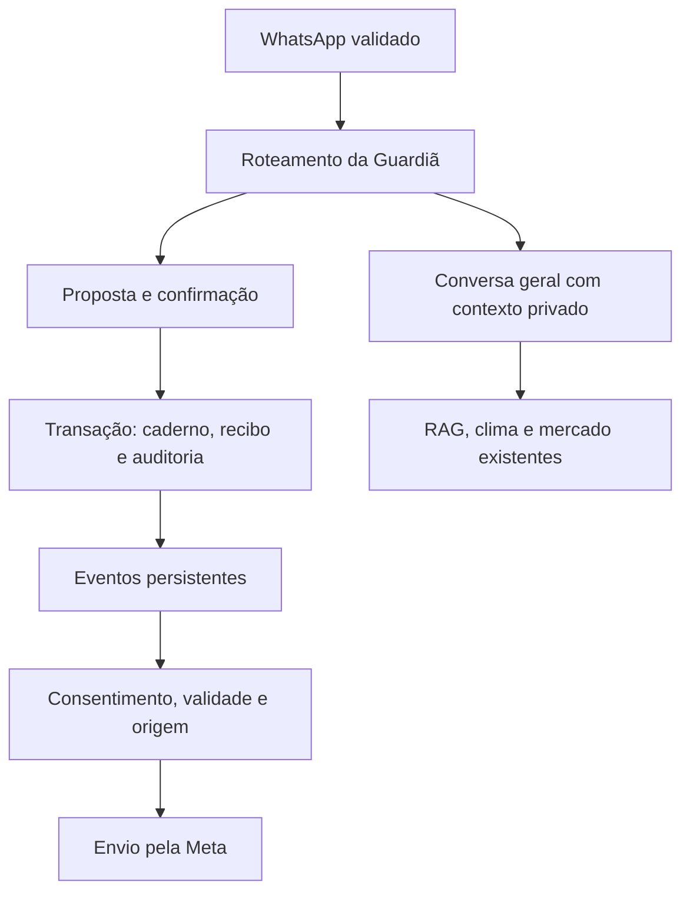

# Guardiã da Fazenda — implementação e homologação

Esta entrega acrescenta um caderno de propriedades e avisos por eventos à arquitetura existente. Os recursos são gratuitos. A integração do código à `main` foi autorizada em 23/10/2026; a homologação do ambiente integrado e a ativação dos novos serviços ainda precisam ser concluídas.

## Arquitetura e integração

- O webhook e o transporte de WhatsApp existentes continuam validando a origem e controlando recebimento, retries, histórico e entrega.
- `conversation.server.ts` observa todas as entradas antes do roteamento. A Guardiã processa registros estruturados antes do modelo geral. Uma propriedade ativa não pode cair no caderno individual de outro escopo.
- A proposta contém propriedade, origem e validade de 30 minutos. A confirmação grava caderno, recibo, auditoria e eventos na mesma transação. Conflitos de versão fazem o servidor recarregar o estado; falhas não produzem uma confirmação de gravação.
- O contexto geral recebe somente uma seleção explicitamente parcial dos dados confirmados da propriedade ativa. A memória privada combina recuperação lexical/temporal existente com episódios semânticos, vizinhos e ranking por entidades/recência. Conversas privadas de outros integrantes não são compartilhadas.
- O caderno de rebanho individual existente foi preservado. `Usar anotações anteriores` retoma esse escopo; `usar fazenda NOME/ID` seleciona uma propriedade. Não há migração ou compartilhamento implícito dos dados antigos.
- O agendador existente da Netlify chama a manutenção, que processa memória e Guardiã independentemente. Falha em clima ou relatórios não interrompe os eventos já enfileirados.

## O que funciona nesta versão

| Área                 | Comportamento implementado                                                                                                                                                                                                                                    |
| -------------------- | ------------------------------------------------------------------------------------------------------------------------------------------------------------------------------------------------------------------------------------------------------------- |
| Propriedades         | Criar, selecionar, descrever atividade/objetivos/alimentação e excluir a propriedade com confirmação de seu proprietário.                                                                                                                                     |
| Equipe               | Proprietário, gerente, funcionário e responsável técnico. Convite vinculado ao telefone, aceitação, revogação e vínculo web de uso único.                                                                                                                     |
| Caderno              | Manejo, nascimentos com quantidade, compras, movimentações e ocorrências sanitárias como relatos. Texto e áudio transcrito entram no mesmo fluxo de revisão.                                                                                                  |
| Rebanho              | Identificação, sexo, raça, nascimento, lote, movimentação, pesos por data, distinção de estimativas e correções com preservação do valor e origem anteriores.                                                                                                 |
| Tarefas              | Criar, concluir, cancelar, editar e reagendar, vincular lote e responsável autorizado; registrar histórico e cancelar lembretes obsoletos.                                                                                                                    |
| Financeiro           | Receitas/despesas em centavos, data, descrição, categoria/lote, exclusão revisada, consulta por período/lote e saldo dos lançamentos. Custos incompletos não são chamados de lucro líquido.                                                                   |
| Calculadoras         | GMD, matéria seca/matéria natural com percentuais informados, alimentação, conversão, custo por kg, custo por cabeça, saldo/margem e cenário de preço de venda.                                                                                               |
| Contexto de cálculos | GMD e alimentação têm gramática conservadora no chat. “Faz o mesmo para 50” pode alterar cabeças de um cenário anterior reconhecido; não adivinha variáveis ausentes. As oito ferramentas também estão no painel.                                             |
| Avisos               | Tarefas, avisos meteorológicos oficiais aplicáveis à localidade confirmada e relatórios opcionais da propriedade selecionada. Sem disparos genéricos de duas mensagens por dia.                                                                               |
| Preferências         | Consentimento documentado, pausa, temas efetivamente disponíveis, horário, frequência diária e intervalo mínimo. Alterar horários não ativa mensagens.                                                                                                        |
| Relatórios           | Consulta por propriedade, lote e período; resumo automático diário/semanal/mensal opcional; JSON, CSV, relatório de texto e impressão do relatório completo para salvar em PDF pelo navegador.                                                                |
| Painel               | `/guardia`, com oito áreas: visão geral, tarefas, rebanho, caderno, financeiro, eventos, calculadoras e equipe/dados. Ligação no painel administrativo de IA.                                                                                                 |
| RAG                  | Reindexação preparada antes da gravação, substituição transacional, proteção por versão/hash e metadados de origem. Não adiciona novos documentos científicos automaticamente.                                                                                |
| Memória privada      | Busca híbrida de originais e episódios semanticamente relacionados, com correções posteriores, fonte por turno, limites explícitos e fallback independente. Embeddings privados ficam separados da base técnica e são opcionais por configuração do servidor. |

Os identificadores, totais e relatórios referem-se apenas ao que está cadastrado. Um caderno vazio não prova ausência de animais ou atividades. O cadastro da propriedade não equivale a monitoramento por sensores.

## Permissões

Todas as tabelas novas têm RLS. Escritas usam RPCs `SECURITY INVOKER` restritas ao servidor. Os endpoints web autenticados validam acesso e obtêm o telefone do vínculo verificado, sem aceitar um telefone arbitrário para representar outro usuário. Os dados compartilhados são os registros da propriedade; integrantes ativos podem consultá-los. O papel limita as alterações:

| Papel                             | Alterações permitidas                                                                                                                               |
| --------------------------------- | --------------------------------------------------------------------------------------------------------------------------------------------------- |
| Proprietário                      | Registros, perfil, financeiro, convites, revogação e exclusão da propriedade.                                                                       |
| Gerente                           | Registros, perfil, financeiro e convites; não revoga o proprietário nem exclui a propriedade. A revogação nesta versão é exclusiva do proprietário. |
| Funcionário / responsável técnico | Registros de campo, animais, pesagens, movimentações e tarefas. Não alteram finanças nem acessos.                                                   |

Administradores do sistema têm leitura pela política administrativa. Esta entrega não cria uma autorização irrestrita para um administrador representar o telefone de um produtor.

## Entrega de eventos

- Chave única por propriedade, destinatário e acontecimento; claims persistentes, fencing por token e concorrência por destinatário.
- Revalidação de consentimento, permissão, janela de horário, validade e versão da tarefa antes do início do envio.
- Expiração e cancelamento de tarefas concluídas/reagendadas, acesso revogado ou consentimento retirado.
- `429` permite retry com backoff e limite de tentativas. Rejeição definitiva da Meta termina em falha. Timeout, resposta ambígua ou perda de recibo após despacho ficam incertos, sem reenvio automático.
- Uma chamada aceita precisa fornecer ID de mensagem da Meta. “Aceito pela Meta” não é confirmação de leitura ou entrega ao aparelho.
- A janela de serviço usa a última entrada real do WhatsApp. Fora dela, o envio exige o template configurado e aprovado. Não é permitido converter silenciosamente um template ausente em texto livre.
- O histórico de estados fica em `guardian_event_history`; o painel mostra eventos, estados atuais, tentativas, motivos, evidências e a sequência cronológica de processamento de cada aviso. A consulta é feita sob a sessão autenticada e RLS do evento; revogar acesso também bloqueia novas consultas ao histórico. Históricos acima de 200 mudanças indicam explicitamente a cobertura parcial.
- O cancelamento não pode desfazer uma requisição já iniciada junto ao provedor. O fluxo evita reenvios automáticos após resultado incerto; não promete entrega exatamente uma vez através de uma rede externa.

Os avisos de clima novos usam boletins oficiais com fonte, localidade, data e vigência. Não foram criados limiares próprios que declarem geada, estresse térmico, doença ou seca a partir de informação insuficiente. Os modelos de previsão existentes continuam disponíveis nas consultas gerais.

## Memória híbrida privada

- `WHATSAPP_SEMANTIC_MEMORY_ENABLED=true` habilita uma camada adicional sobre o arquivo original. Ausente, o caminho lexical/temporal continua funcionando sem chamadas novas de embeddings privados.
- A busca semântica é usada para retomadas e referências implícitas. Pedidos de data exata usam o arquivo temporal; perguntas gerais e cumprimentos não geram embeddings privados.
- A fusão usa ranking recíproco, recência e entidades explícitas, distinguindo, por exemplo, lote 2 de lote 20. O contexto preserva originais, respostas antigas como evidência não verificada e correções posteriores; não promove similaridade a fato confirmado.
- O agendador existente indexa até quatro turnos por execução (limite interno máximo de oito) e até 200 por dia em toda a plataforma por padrão. `WHATSAPP_SEMANTIC_MEMORY_DAILY_BUDGET` configura esse teto técnico de indexação entre 1 e 10.000; falhas também consomem a cota para limitar retries e custo. O chat e a recuperação lexical continuam disponíveis quando a cota acaba.
- A geração cobre mensagens concluídas de 4 a 6.000 caracteres nos últimos 180 dias e após o reset do remetente. As consultas usam até 2.000 episódios vetorizados recentes do mesmo telefone e seus vizinhos, com cobertura explicitamente parcial. Há cache temporário de embeddings de consulta por telefone, sem texto original como chave, e chamadas com timeout e sem retries no caminho interativo.
- Claims persistentes, limite de quatro tentativas, backoff, hash da origem e modelo/dimensões impedem reutilizar vetores de uma origem alterada ou de outro modelo. Um reset remove os vetores anteriores; uma tarefa atrasada não pode recriá-los. Excluir o turno original também exclui seu vetor derivado.
- Tabelas e RPCs vetoriais são exclusivas do servidor, com RLS e permissões revogadas para clientes. Nenhuma mensagem privada entra na base técnica compartilhada, em erros do provedor ou em logs novos. Os eventos de uso das consultas preservam apenas metadados e contadores.
- Os testes usam vetores sintéticos em pgvector real/PGlite e avaliações determinísticas de conversa. A relevância com embeddings do provedor e o desempenho na escala de produção ainda precisam de homologação; não há garantia de recuperar todo episódio antigo.

## Migrações novas

Aplicar na ordem, primeiro em homologação isolada:

1. `20261023201318_guardian_farm_foundation.sql`: tabelas, índices, RLS, vínculos, convites, snapshot, transação de gravação e pausa dos slots proativos antigos.
2. `20261023202236_guardian_durable_events.sql`: histórico de processamento, claims, fencing, início/finalização de envio, recuperação de leases, cancelamento e coleta de clima.
3. `20261023203738_guardian_optional_reports.sql`: coleta de relatórios opcionais com cursor persistente.
4. `20261023203952_knowledge_atomic_replacement.sql`: substituição transacional dos trechos de um documento.
5. `20261023213658_guardian_event_history_access.sql`: leitura do histórico de avisos sob a mesma autorização e RLS do evento da propriedade, sem escrita pelo cliente.
6. `20261023214657_private_semantic_memory.sql`: vetores privados, orçamento de indexação, claims, busca por similaridade com isolamento por remetente e expurgo dos derivados após reset/exclusão.

São adições ao esquema existente. A primeira migração desativa os acompanhamentos antigos e marca sua fila pendente como substituída, preservando o histórico. Essa mudança operacional exige revisão antes de produção. A migração de conhecimento deve acompanhar a nova versão do código que a invoca: sem a RPC no PostgREST, a reindexação retorna uma orientação de migração e preserva os trechos existentes. As consultas aos documentos já indexados continuam no caminho existente.

Não remover tabelas para voltar uma versão depois que existirem registros reais. O rollback operacional recomendado é desativar as flags, cancelar os envios novos que ainda não iniciaram e preservar os dados para correção. Para remoção integral do esquema, preparar backup e uma revisão específica; não há script destrutivo automático nesta entrega.

## Configuração externa necessária

| Variável / recurso                                                         | Finalidade                                                                                                                                      |
| -------------------------------------------------------------------------- | ----------------------------------------------------------------------------------------------------------------------------------------------- |
| `TPEC_GUARDIAN_ENABLED=true`                                               | Habilita os fluxos novos. Ausente, a Guardiã permanece desativada.                                                                              |
| `WHATSAPP_PROACTIVE_ENABLED=true`                                          | Permite executar a manutenção agendada já existente.                                                                                            |
| `WHATSAPP_SEMANTIC_MEMORY_ENABLED=true`                                    | Habilita a indexação e busca semântica privada após a migração e homologação; ausente mantém a recuperação anterior.                            |
| `WHATSAPP_SEMANTIC_MEMORY_DAILY_BUDGET`                                    | Teto diário global de turnos indexados, padrão 200. Controle técnico gratuito, sem bloquear o chat.                                             |
| `SUPABASE_SERVICE_ROLE_KEY` e configurações Supabase existentes            | Exclusivamente no servidor; nunca usar prefixo `VITE_` para segredos.                                                                           |
| `WHATSAPP_ACCESS_TOKEN`, `WHATSAPP_PHONE_NUMBER_ID`, `WHATSAPP_APP_SECRET` | Transporte e agendador existentes, somente no servidor.                                                                                         |
| `WHATSAPP_GUARDIAN_TEMPLATE_NAME`                                          | Nome de um template aprovado, compatível com um parâmetro de texto no corpo. Não reutilizar um template incompatível sem verificar seu formato. |
| `WHATSAPP_GUARDIAN_TEMPLATE_LANGUAGE`                                      | Idioma do template; padrão `pt_BR`.                                                                                                             |
| `WHATSAPP_GRAPH_API_VERSION`                                               | Versão da Graph API já configurada; validar compatibilidade em homologação.                                                                     |
| Provedores de IA já configurados                                           | Interpretação de propostas ambíguas; registros e cálculos determinísticos não dependem de geração para seu resultado.                           |

Configurar variáveis de execução no painel/API da Netlify, nos escopos e contextos adequados. Variáveis de build no `netlify.toml` não substituem a configuração das funções em execução. A manutenção da Guardiã também rejeita contexto de deploy diferente de produção quando `CONTEXT` estiver presente.

Sequência recomendada:

1. Criar ambiente Supabase de homologação separado; não usar dados reais nos testes.
2. Aplicar e revisar as seis migrações, permissões e advisors nesse ambiente.
3. Verificar os endpoints reais via PostgREST e autenticação, inclusive tentativa de outra propriedade e revogação com uma sessão existente.
4. Validar os provedores, o telefone de teste da Meta e o template, inclusive fora da janela de atendimento.
5. Fazer um ensaio controlado do agendador, da falha de provedor e da retomada, com números autorizados para teste.
6. A autorização de integração à `main` já foi concedida. Aplicar as migrações de produção e ativar as flags somente após a homologação e a autorização correspondente; recolher o consentimento dos produtores antes de avisos.

## Validação executada

- Suíte Node: 770 testes aprovados, zero falhas, incluindo os testes anteriores.
- A suíte completa também passou com `CONTEXT=deploy-preview`. Os testes injetam explicitamente o contexto necessário ao processamento sintético e verificam que o agendador real permanece desabilitado em previews.
- Testes novos de banco: execução das migrações em PostgreSQL local via PGlite, sem conectar a uma base de produção. Verificam RLS, papéis, acesso anônimo, isolamento, convite vinculado ao telefone, revogação inclusive do histórico de avisos, vínculo web de uso único, recibos, CAS, fila, cancelamento e rollback da indexação.
- Testes de cálculos: unidades, fórmulas, zero, ganho negativo, entradas inválidas, estimativas e cenários.
- Testes de WhatsApp: transcrição/confirmar, contexto da fazenda, não cair em outro caderno, falha de gravação, replay e expiração de proposta.
- Memória: busca semântica e fusão híbrida, retomadas da novilha/lote/ração/análise, distinção de identificadores, correções sob orçamento de contexto, fallback, timeout/erros sem texto privado, pgvector real, isolamento por telefone/modelo, reset durante claim, atualização/exclusão da origem, fencing, orçamento e backoff.
- Build, typecheck, importação dos cinco módulos de rota e varredura de segredos no bundle cliente aprovados.
- Auditoria de imports privilegiados aprovada.
- Lint: zero erros; avisos preexistentes de hooks/fast refresh permanecem em arquivos legados.
- UI local em Chromium: desktop 1440×1050 e celular 390×844, oito áreas, ausência de overflow horizontal do documento, histórico de processamento e sua atualização, cálculo, entrada inválida e formulário que apenas prepara uma proposta. Foram usados somente dados sintéticos e bloqueadas requisições externas.

Limites dessa validação: o runtime local era Node 24.19.0; o projeto/CI continuam fixados em 24.22.1. Os resultados remotos de cada revisão estão no [PR #74](https://github.com/Organizacao-DuKamp/IA-Dukamp/pull/74). Permanecem pendentes a homologação da Meta/Supabase/PostgREST, teste multissessão de locks num servidor Postgres separado e avaliação veterinária. Os testes exercitam pgvector local e as transações, mas não substituem a validação das permissões, versão da extensão, relevância dos embeddings e carga do ambiente real.

## Escopo ainda não concluído do plano TPEC-IA 2.0

Esta entrega não conclui integralmente as seis etapas do plano mestre. Permanecem:

- Calibração da relevância semântica com o provedor e o acervo autorizado, testes de carga e ampliação dos cenários de memória de longo prazo. A busca híbrida privada e suas avaliações determinísticas já estão implementadas; a indexação tem limites explícitos e ainda precisa ser habilitada após homologação.
- Importação em massa, revisada, de planilhas/PDFs/fotos para o novo caderno, e migração explícita do rebanho individual para uma propriedade compartilhada.
- Formulação nutricional, exigências de BR-CORTE/NASEM/CQBAL e estimativas de desempenho validadas por especialistas. As oito ferramentas entregues são aritméticas e não formulam uma dieta.
- Nova coleção científica com licenças, edições, revisão e ingestão de documentos efetivamente autorizados. O pipeline foi reforçado; novos acervos não foram baixados nem incorporados automaticamente.
- Alertas de cotação por limiar, alertas financeiros configuráveis, detecção longitudinal de desempenho e acompanhamento sanitário automático como fontes próprias de eventos. Clima/tarefas/relatórios são as fontes ativas nesta versão.
- Comparação clínica longitudinal de fotos, anexos sanitários estruturados e encaminhamento operacional autorizado a profissionais. As capacidades multimodais anteriores permanecem, com a política de não diagnosticar/prescrever individualmente.
- Conciliação financeira, contas a pagar/receber, fluxo de caixa contábil e projeções mais completas. O saldo dos lançamentos não inclui custos que não foram informados.
- Analytics produtivo avançado, alertas administrativos específicos de orçamento e painéis novos de qualidade por resposta. Os painéis de uso/custo existentes foram preservados.
- Exclusão/retificação LGPD abrangendo cada provedor, logs, conversas, backups e fontes externas. Excluir uma propriedade remove o caderno da Guardiã e suas relações; não deve ser apresentado como apagamento universal de todos os históricos da plataforma.

Nenhum desses itens deve ser divulgado como recurso já pronto desta versão.

## Referências de implementação

- [Supabase: Row Level Security](https://supabase.com/docs/guides/database/postgres/row-level-security)
- [Netlify: Scheduled Functions](https://docs.netlify.com/build/functions/scheduled-functions/)
- [Meta: mensagens de serviço](https://developers.facebook.com/documentation/business-messaging/whatsapp/messages/send-messages)
- [Meta: fundamentos de templates](https://developers.facebook.com/documentation/business-messaging/whatsapp/templates/overview)
- [Embrapa: definições de eficiência alimentar](https://ainfo.cnptia.embrapa.br/digital/bitstream/item/164236/1/Pecuaria-de-leite-no-Brasil.pdf)
